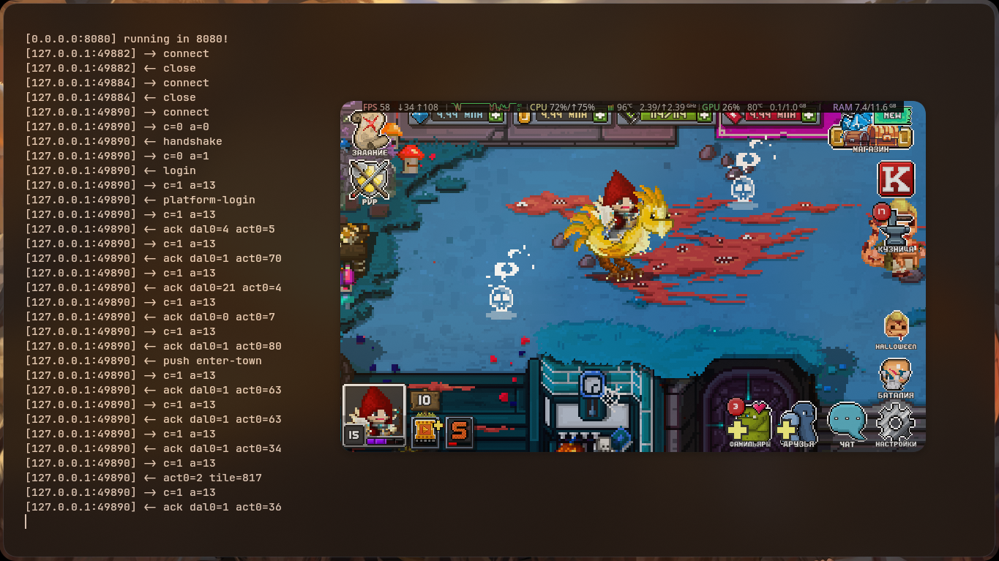

This is the Bit Heroes server emulator, last version, written in Zig.

# Requirements

- [Zig (0.18.0)](https://ziglang.org/download/)
- Desktop (with support x86_64)
- Brain..? 🧑🏿‍🦯

# Server

## Building

```bash
git clone https://github.com/fmznkdv/ReversalBH
cd ReversalBH
```

## Running

```bash
zig run Master.zig -O ReleaseSmall
```

The server will start listening on `0.0.0.0:8080` by default.
